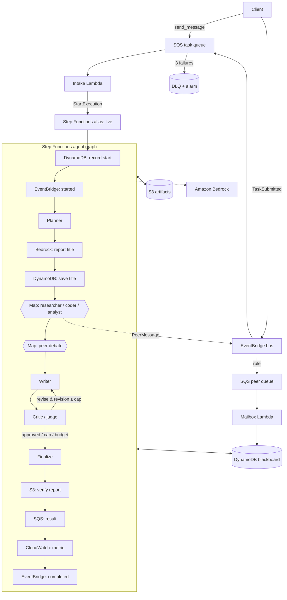

# Multi-Agent Collaboration System on AWS

Specialised AI agents (**planner, researcher, coder, analyst, writer, critic**) coordinate through a
graph/state machine to solve tasks too complex for a single agent. It's built with LangGraph-style
orchestration on Amazon Bedrock and AWS Step Functions.

## Requirement → implementation

| Requirement | Where it is implemented |
|---|---|
| Specialised agents (researcher, coder, critic, planner) | `src/agents/prompts.py`, `src/handlers/{planner,specialist,writer,critic}.py` |
| Supervisor–worker pattern | Planner delegates subtasks to researcher / coder / analyst (Step Functions **Map**) |
| Peer-to-peer debate | Second Map round: each specialist critiques its peers' notes (`specialist.py`, `mode=debate`) |
| Hierarchical delegation | Planner → specialists → writer → critic (two levels below the planner) |
| Shared state / memory design | DynamoDB blackboard with an explicit read/write contract (`src/common/memory.py`) |
| Cyclic graphs + conditional routing | Writer ⇄ Critic loop with a `Choice` state (Step Functions) and the same graph in LangGraph (`src/workflow/local_graph.py`) |
| Conflict resolution (critic/judge) | Critic judges the draft and must list `unresolved_conflicts` from the debate |
| Cost/latency trade-offs vs a single agent | Token, cost and latency tracking per agent call; `scripts/compare_single_vs_multi.py` |
| **Amazon Bedrock**: LLM backend for each agent | Nova Lite via the Converse API (LangChain) + one direct Step Functions → Bedrock call |
| **Step Functions**: agent graph as a state machine | `infra/stack.py`; definition versioned in `asl/collaboration_workflow.asl.json` |
| **Lambda**: agent execution units | 6 agent/worker functions + intake, mailbox and failure handlers |
| **DynamoDB**: blackboard | `MSG#…` (agent outputs), `USAGE#…` (tokens), `META` (task state) |
| **SQS / EventBridge**: async peer messaging | `PeerMessage` events → EventBridge rule → SQS → mailbox Lambda → agent inboxes |
| **S3**: intermediate artifacts | `notes/`, `code/`, `debate/`, `critiques/`, `drafts/`, `final.md`, `run_summary.json` |
| **CloudWatch + X-Ray**: trace the execution graph | X-Ray on Lambda and Step Functions, dashboard, alarms, custom metric |
| CI: fixed scenarios, valid termination | `tests/scenarios/*.json` + `tests/test_scenarios.py` + `tests/test_termination.py` |
| Versioned ASL in git, deployed via CDK | `asl/` + `scripts/export_asl.py --check` + Step Functions versions and a `live` alias |
| Staged prompt rollout (shadow run) | Prompt sets `v1`/`v2`, `shadow_prompt_version`, `scripts/compare_prompts.py` |
| Cost-guardrail tests in CI | Token/USD budget per scenario (build fails if exceeded) + runtime `TOKEN_BUDGET` |

## Architecture



### Shared state: who reads and writes what

| Agent | Writes | Reads |
|---|---|---|
| planner | `MSG#planner` | task request |
| researcher / coder / analyst | `MSG#<agent>#i`, S3 `notes/` or `code/`, `PeerMessage` event | request + its instruction |
| `<agent>-debate` | `MSG#<agent>-debate#i`, S3 `debate/` | peers' `MSG#<specialist>#j` |
| mailbox | `MSG#inbox-<agent>#i` | SQS peer queue |
| writer | S3 `drafts/v<N>.md` | specialist + debate messages, previous draft, critic feedback |
| critic | `MSG#critic#N`, S3 `critiques/v<N>.json` | draft + debate messages |
| every agent call | `USAGE#<agent>#i` (tokens, latency) | — |
| finalize | `META` summary, S3 `final.md`, `run_summary.json` | all `USAGE#` items |

### Termination: three independent loop guards
1. **Critic:** stops revising after `max_revisions` rewrites, or once the task has used `token_budget` tokens.
2. **State machine:** the `Approved or revise?` Choice state only loops while `$.revision <= max_revisions`, and the execution has a 30-minute hard timeout.
3. **CI:** `tests/test_termination.py` proves that every cycle in the versioned ASL has a numeric guard. `tests/test_scenarios.py` runs adversarial scenarios (for example, a critic that never approves) under a recursion limit.

## Project layout
```
app.py, cdk.json            CDK entry point + config (model, limits, budget, prompt versions)
infra/stack.py              every AWS resource
asl/                        exported Step Functions definition (versioned in git)
src/agents/                 prompts (v1, v2) + LangGraph agent loop with token tracking
src/handlers/               intake, planner, specialist (work + debate), mailbox, writer, critic, finalize
src/common/                 config, DynamoDB blackboard, S3 storage, events, Bedrock/fake LLM, X-Ray
src/workflow/local_graph.py the same agent graph in LangGraph (local runs, CI)
src/web/index.html          the website (served by the WebApi Lambda)
infra/github_oidc.py        one-time OIDC deploy role for GitHub Actions
scripts/                    mas.py (client), run_local.py, run_scenarios.py, compare_prompts.py,
                            compare_single_vs_multi.py, export_asl.py
tests/                      unit, scenario, cost-guardrail and termination tests
.github/workflows/          CI (tests, guardrails, ASL drift) and CD (CDK deploy + live smoke tests)
```

## Deploy (AWS CloudShell)
1. Enable **Amazon Nova Lite** in the Bedrock console (Model catalog).
2. Upload the zip to CloudShell, then run:
```bash
rm -rf multi-agent-collaboration-system && unzip -o multi-agent-collaboration-system.zip
cd multi-agent-collaboration-system && pip3 install -r requirements.txt
cdk bootstrap                                   # once per account/region
cdk deploy MultiAgentCollaborationStack         # model, budget and prompt version come from cdk.json
```
`cdk.json` defaults to `apac.amazon.nova-lite-v1:0` (Sydney/Mumbai). For US regions, use `-c model_id=us.amazon.nova-lite-v1:0`.

## Website
The stack prints a **WebsiteUrl** output. Open it to type a question and watch the agents work live:
a six-stage relay (plan, specialists, debate, write, critique, answer), every agent's message as it
lands on the blackboard, the critic's verdicts, and the final report with time, calls, tokens, cost and
score. One Lambda behind an API Gateway HTTP API serves the page (`src/web/index.html`) and the JSON API:

| Route | What it does |
|---|---|
| `GET /` | The website |
| `POST /api/tasks` | Submit a question (sent to the same SQS task queue) |
| `GET /api/tasks/{id}` | Live status, agent messages, usage and the final report |

The API is throttled to 2 requests/second (burst 5) so the public URL can't run up the Bedrock bill.
To require a code for submitting questions, deploy with `-c site_access_code=<code>`.

## Use it from the command line
```bash
TASK=$(python3 scripts/mas.py submit "Design a URL shortener service and recommend a database")
python3 scripts/mas.py result $TASK --wait     # final report + run summary
python3 scripts/mas.py summary $TASK           # tokens, cost, latency, stop reason, score
```
Then open:
- **Step Functions → CollaborationWorkflow → execution → Graph view**: every service is a named step.
- **DynamoDB → Explore items**: the blackboard (planner, specialists, debate, inboxes, critic, usage).
- **S3 → tasks/<id>/**: notes, code, debate, critiques, drafts, final report, run summary.
- **CloudWatch dashboard** and the **X-Ray trace map**.

## Cost / latency trade-off
```bash
python3 scripts/compare_single_vs_multi.py "Design a URL shortener service and recommend a database"
```
This runs the same request as a single well-prompted call and through the multi-agent workflow, then
has an independent judge score both. It prints tokens, estimated cost, latency, the number of LLM
calls and the score, which shows what the extra quality costs.

## CI/CD
| Stage | What runs | Fails the build when |
|---|---|---|
| **CI** (`ci.yml`, every push/PR) | `pytest`: unit, 5 fixed scenarios, termination checks | a scenario doesn't terminate, behaves unexpectedly, or **exceeds its token/USD budget**; any cycle in the ASL is unguarded |
| | `scripts/export_asl.py --check` | the state machine changed but `asl/` wasn't regenerated and committed |
| | `cdk synth` | the infrastructure doesn't synthesize |
| **CD** (`deploy.yml`, main + manual) | `cdk deploy -c git_sha=…` | the deploy fails |
| | publishes a new **Step Functions version** and points the `live` alias at it | — |
| | `scripts/run_scenarios.py` (real Bedrock) | a live scenario fails, is slower than its limit, or exceeds its live budget |

**Run CI locally:** `pip install -r requirements-dev.txt && pytest -v && python scripts/export_asl.py --check`

**After changing the workflow:** run `python scripts/export_asl.py` and commit `asl/`.

**Rollback:** in the Step Functions console, open **Aliases → live** and point it at a previous version. Old versions are retained on update.

**One-time CD setup** (CI needs none of this and runs on every push):
1. In CloudShell: `cdk deploy GitHubDeployRoleStack`. This creates GitHub's OIDC provider and a deploy role
   that only workflows from this repository can assume, so no AWS keys are stored in GitHub.
2. In GitHub, go to **Settings → Secrets and variables → Actions**:
   - **Secrets:** add `AWS_DEPLOY_ROLE_ARN` = the `RoleArn` output from step 1.
   - **Variables:** add `AWS_REGION` = `ap-southeast-2` (or your region).
3. From then on, every push to `main` that passes CI deploys automatically and runs the live smoke scenarios.
   **Actions → Deploy → Run workflow** deploys manually, including shadow prompt rollouts.

### Staged prompt rollout (shadow run)
1. Add or modify a prompt set in `src/agents/prompts.py` (for example `v2`).
2. Deploy it as a shadow: `cdk deploy -c shadow_prompt_version=v2`. Every task now also runs as
   `<task_id>-shadow` with v2. Users only see the v1 result.
3. Compare: `python3 scripts/compare_prompts.py <task_id> [...] --show`. This shows score, cost,
   revisions and latency side by side, with a promote/keep suggestion.
4. Promote: `cdk deploy -c prompt_version=v2 -c shadow_prompt_version=`

## Local development (no AWS needed)
```bash
pip install -r requirements-dev.txt
pytest -v
python scripts/run_local.py --fake "Compare SQS and Kinesis"   # offline fake model
python scripts/run_local.py "Compare SQS and Kinesis"          # real Bedrock, local orchestration
```

## Cost and cleanup
Everything is serverless and pay-per-use. Each task makes about 11 LLM calls (planner, 3 specialists,
3 debate turns, and 2 writer + 2 critic calls when one revision is needed). Every task's tokens and estimated cost are
recorded in its run summary. The prices in `cdk.json` approximate Nova Lite on-demand pricing; check the Bedrock
pricing page for your region. Remove everything with `cdk destroy`.
